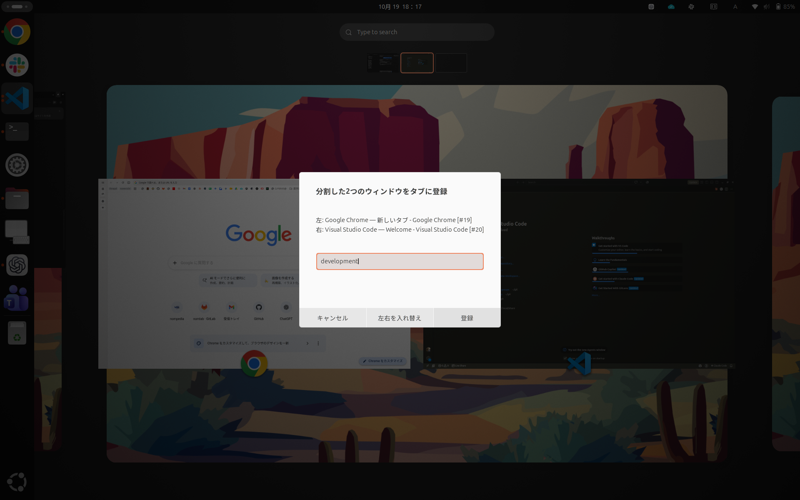
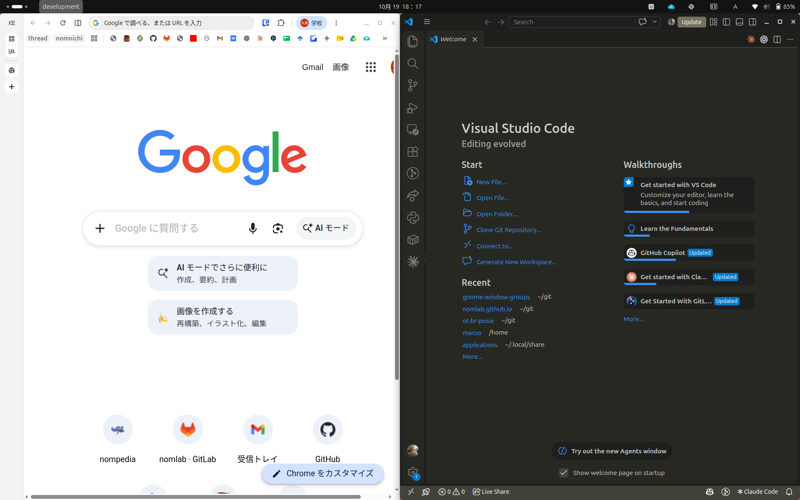
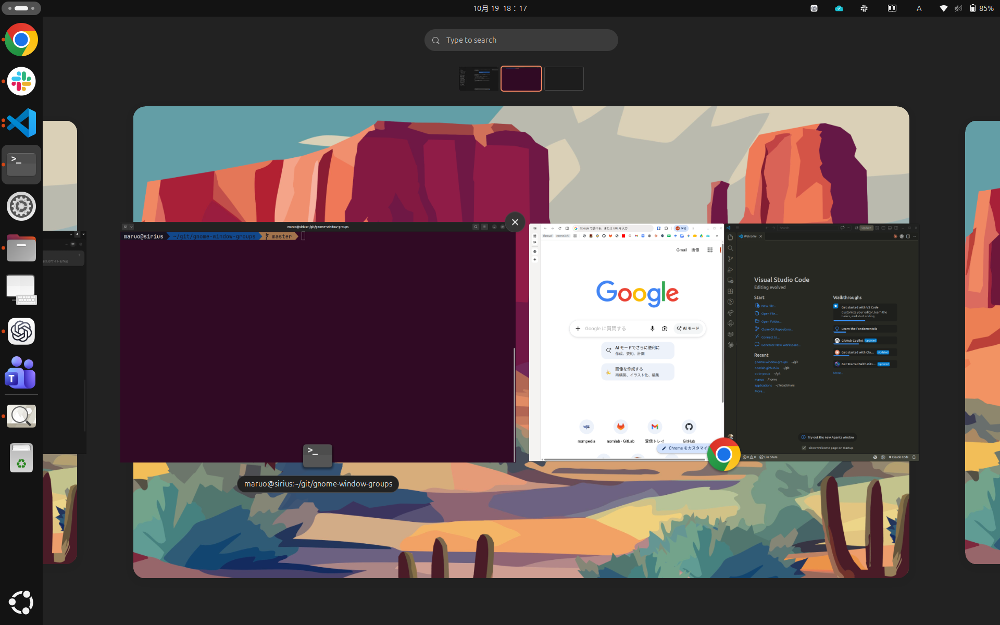
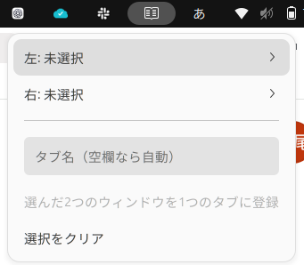
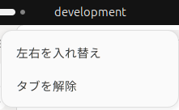

# Window Groups

**2つのウィンドウを，1組のタブとして切り替える GNOME Shell 拡張機能である．**

Chrome と VS Code など，作業で一緒に使うウィンドウをまとめて管理可能である．同じアプリの複数ウィンドウにも対応している．

## 1．ドラッグ＆ドロップでタブを作成

アクティビティ画面でウィンドウをもう一方へドラッグし，タブ名を付けて登録する．登録前に左右を入れ替えることもできる．



## 2．タブをクリックして，2つのウィンドウを表示

トップバーのタブをクリックすると，登録したウィンドウを左右に並べて表示する．複数のタブを作成すると作業ごとの組み合わせを切り替えられる．



### 3．アクティビティ画面でもグループ化

登録した2つのウィンドウは，アクティビティ画面でも1枚のプレビューとして表示する．そのまま別のワークスペースへまとめて移動できる．



---

各アプリは独立したウィンドウのまま動作する．Dock や Alt+Tab では個別に扱われ，GNOME の標準ショートカット設定は変更しない．

## 対応環境

- Ubuntu 24.04 / GNOME Shell 46
- Wayland を優先した実装

他の GNOME バージョンは対応対象外である．自動整列やアクティビティ画面を変更する他の拡張機能とは，競合する場合がある．

## インストール
- `gnome-extensions` コマンドを使用
- `sudo` 不要

### 1．ソースを取得してインストール

1. 本リポジトリを clone し，移動する

```sh
git clone https://github.com/ryunosuke0115/gnome-window-groups.git
cd gnome-window-groups
```
2. インストール用 ZIP を `dist/` に作成し，それをインストールする

```sh
sh scripts/pack.sh
gnome-extensions install --force dist/window-groups@local.dev.shell-extension.zip
```

### 2．再ログインして有効化

1. 作業中のファイルを保存し，**一度ログアウトしてログインし直す**
2. ターミナルで以下のコマンドを実行する

```sh
gnome-extensions enable window-groups@local.dev
```

トップバーの右側に**左右分割のアイコン** が表示されれば，有効化できている．アイコンをクリックすると以下のようにメニューが開く．



Wayland では `Alt+F2` → `r` による Shell の再起動は使えないため，再ログインする必要がある．

インストール先は `~/.local/share/gnome-shell/extensions/window-groups@local.dev/` である．ソースとは別の場所へコピーするため，インストール後にソースのディレクトリを移動しても動作に影響しない．

## タブを作成

### 方法1．ウィンドウをドラッグして登録する

1. 同じワークスペースに，まとめたいウィンドウを2つ開いた状態でアクティビティ画面を開く
2. 一方のウィンドウのプレビューをもう一方へドラッグし，相手が青枠になったら離す
3. 名前入力画面の「左」「右」を確認，逆にしたい場合は「左右を入れ替え」を押す
4. タブ名を入力し，「登録」を押下，Enter でも確定できる

初期状態は**ドロップ先が左側，ドラッグしたウィンドウが右側**である．「左右を入れ替え」を押すと表示が更新され，登録時にその順序で配置する．入れ替えだけでは登録・配置は行わず，入力したタブ名も保持する．名前入力画面でキャンセルまたは Esc を押した場合は登録しない．

### 方法2．右上のメニューから登録する

1. トップバー右側の左右分割アイコンをクリックする．
2. 「左: 未選択」から左側に置くウィンドウを選ぶ
3. 「右: 未選択」から右側に置くウィンドウを選ぶ
4. タブ名を入力する，空欄なら自動で名前を付ける
5. 「選んだ2つのウィンドウを1つのタブに登録」を押す

一覧はメニューを開くたびに更新する．新しく開いたウィンドウや変更したタイトルが反映されない場合は，メニューを一度閉じて開き直す．

## タブの使用

登録したタブは，トップバーの左側に名前で表示される．
タブを左クリックするとグループ化されたウィンドウが表示される．
タブを右クリックすると以下のような画面になり，左右の入れ替え，タブの解除を行える．



## タブの解除

**片方のウィンドウを以下のように操作すると，そのタブを自動解除する．**

- サイズを変更する
- 最大化・最大化解除・全画面化する
- アプリを終了し，ウィンドウを閉じる

## 更新・無効化・アンインストール

### 更新

`gnome-window-groups` ディレクトリで以下を順に実行する．
1. Window Groups を無効化する
```sh
gnome-extensions disable window-groups@local.dev
```
2. 最新版を取得し，再インストールする
```sh
git pull --ff-only
sh scripts/pack.sh
gnome-extensions install --force dist/window-groups@local.dev.shell-extension.zip
```

3. **一度ログアウトしてログインし直す**．その後，Window Groups を有効化する

```sh
gnome-extensions enable window-groups@local.dev
```

ソースの更新だけでは，インストール済みの拡張機能は更新されない．また，無効化・有効化だけでは読み込み済みのコードが残る場合があるため，再ログインが必要である．

### 無効化

Window Groups を無効化する場合，以下のコマンドを実行する．

```sh
gnome-extensions disable window-groups@local.dev
```
再び使う場合は以下のコマンドで有効化する．

```sh
gnome-extensions enable window-groups@local.dev
```

### アンインストール

Window Groups をアンインストールする場合，以下のコマンドを順に実行する．

```sh
gnome-extensions disable window-groups@local.dev
gnome-extensions uninstall window-groups@local.dev
```

## トラブルシューティング

### 症状から確認する

| 症状 | 確認・対処 |
| --- | --- |
| 右上のアイコンが出ない | 下記のコマンドで GNOME のバージョンと拡張機能の状態を確認する．インストール後は再ログインし，有効化する． |
| 「対象の通常ウィンドウがありません」と表示される | 現在のワークスペースで通常ウィンドウを開き，メニューを開き直す．ダイアログ・全画面表示・移動やリサイズができないウィンドウなどは対象外である． |
| 登録ボタンを押せない | 左右に異なるウィンドウを選ぶ．すでにタブへ登録したウィンドウを使う場合は，先にそのタブを解除する．同じアプリの別ウィンドウは登録できる． |
| ドラッグしても登録画面が開かない | アプリアイコンのグリッドではなく，起動中のウィンドウが並ぶアクティビティ画面で操作する．未登録の通常ウィンドウ同士を選び，ドロップ先が青枠になってから離す． |
| 別ワークスペースでタブが表示されない | 左上のタブと右上の一覧は，現在のワークスペースに所属するタブだけを表示する仕様である．登録したワークスペースへ戻って確認する． |
| 元のワークスペースへ戻ってもタブがない | サイズ変更・最大化・最大化解除・全画面化・ウィンドウの終了・個別のワークスペース移動がなかったか確認する．手動での拡張機能の無効化やログアウトでも登録は消える． |
| アクティビティ画面で2つのプレビューに戻る | 2つが同じモニターにあり，モーダルダイアログを開いていないか確認する．合成表示の条件を満たさない場合は個別表示になる．小さなワークスペースサムネイルも個別表示である． |
| 左右50:50にならない・配置が変わる | アプリの最小サイズによって指定どおりに配置できない場合がある．他の自動整列拡張機能を一時的に無効化して比較し，競合の有無を確認する． |
| 切り替え直後に一瞬だけ大きさや位置が変わる | 最小化からの復元と配置は非同期に進むため，途中の状態が見える場合がある．一瞬の変化か，操作後もずれが残るかを分けて確認し，再現手順や録画を記録する． |
| 一方だけ移動・配置された | 2つのウィンドウへの操作は，一方が成功して他方が失敗する場合がある．タブが残っていれば解除し，手動で配置を整えてから再登録する． |
| 更新しても動作が変わらない | ソース更新後に ZIP を再作成・再インストールしたか確認する．無効化・有効化だけではなく，再ログインしてから試す． |

### 環境と拡張機能の状態確認

ターミナルで以下のコマンドを実行する．

```sh
gnome-shell --version
echo "$XDG_SESSION_TYPE"
gnome-extensions info window-groups@local.dev
```

| コマンド | 確認する内容 |
| --- | --- |
| `gnome-shell --version` | 対応する GNOME Shell 46 系かを確認する． |
| `echo "$XDG_SESSION_TYPE"` | セッション種別を確認する．Wayland セッションでは `wayland` と表示される． |
| `gnome-extensions info window-groups@local.dev` | インストール先，読み込まれているバージョン，有効化状態，動作状態を確認する．正常に動作中なら状態は `ACTIVE` となる． |

拡張機能が見つからない場合は，[インストール手順](#インストール)を確認する．インストール済みで無効になっている場合は，以下のコマンドで有効化する．`ERROR` などの状態なら，下記のログを確認する．

```sh
gnome-extensions enable window-groups@local.dev
```

### エラーログの確認

以下のコマンドを実行したまま問題の操作を再現する．

```sh
journalctl --user -b -f -o cat /usr/bin/gnome-shell
```

GNOME Shell のログが表示されない環境の場合，以下のコマンドなら表示される可能性がある．

```sh
journalctl -b -f -o cat _COMM=gnome-shell
```

`[Window Groups]` を含む行を確認する．読み込みに失敗した場合は，`JS ERROR`・`ImportError`・`window-groups@local.dev` の付近も確認する．他の拡張機能のエラーも混在するため，関係するスタックトレースを含めて記録する．

## 開発・動作確認

- [開発ガイド](docs/DEVELOPMENT.md)：ファイル構成，内部 API，テスト，インストール用 ZIP の作成方法
- [実機テスト手順](docs/MANUAL_TESTS.md)：描画，入力，ジェスチャー，スリープ復帰，複数モニターなどの確認

自動テストでは，模擬ウィンドウ・模擬 UI による処理の検証と，一部の Mutter API の存在確認を行う．実際の描画・入力・ジェスチャーなどは，別途実機で確認する必要がある．

## ライセンス

本プロジェクトのソースコードは，GNU General Public License
バージョン2またはそれ以降（GPL-2.0-or-later）で提供する．
詳細は [LICENSE](LICENSE) を参照．

同梱アイコンには別のライセンスが適用される．
詳細は[アイコンの出典とライセンス](docs/images/NOTICE.md)を参照．
